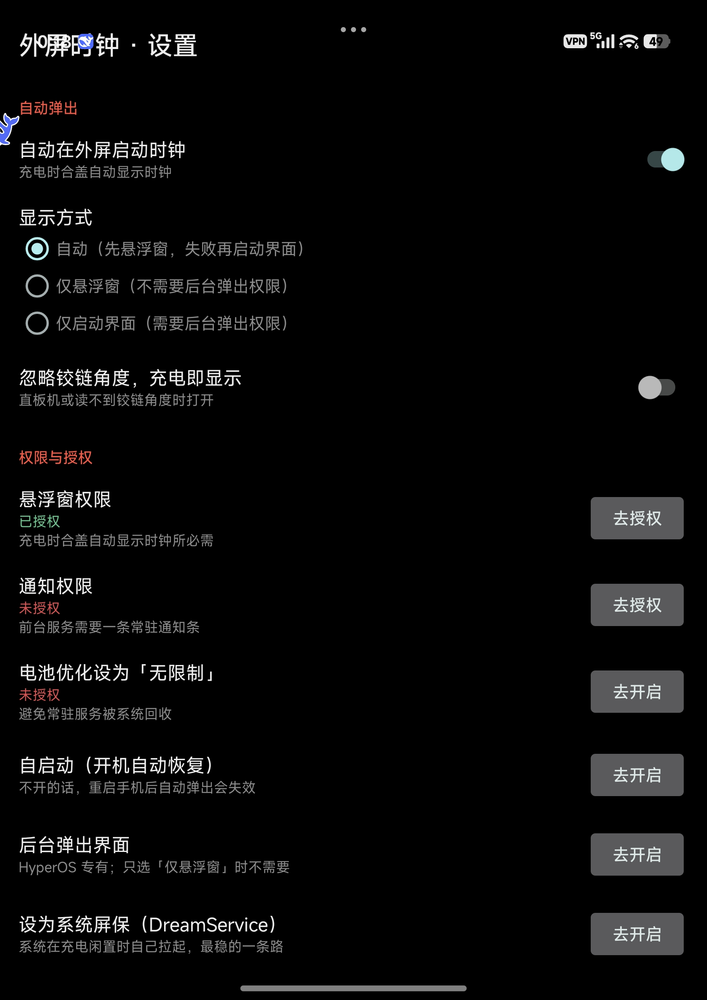
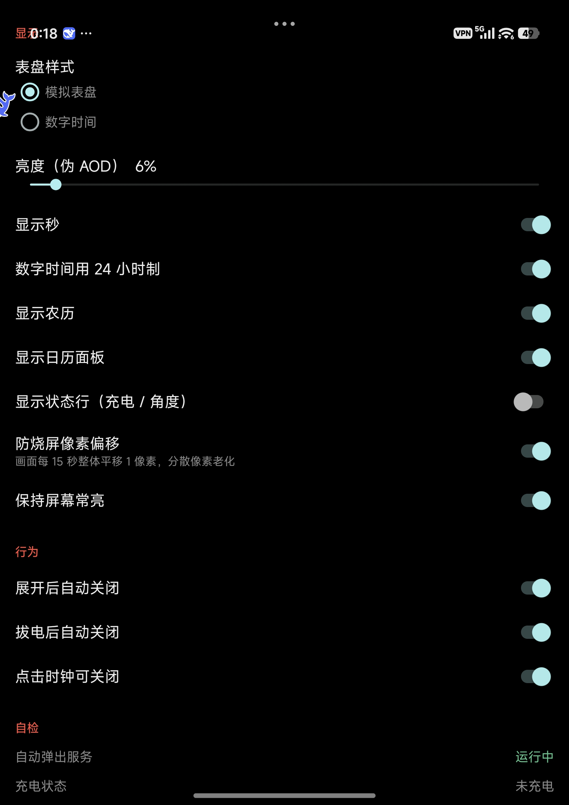

# 外屏时钟 · FoldClock

给折叠屏**外屏**做的一个极简时钟：合盖、插电，外屏自动亮起；纯黑背景 + 防烧屏像素偏移，适合长时间挂着当桌面钟。

> 面向小折叠（小米 MIX Flip 系等）外屏调教，Android 12L（API 32）及以上可装。
> 其他机型/直板机也能装，但外屏行为以实机为准。


| 设置 · 自动弹出 / 权限引导 | 设置 · 显示与行为 |
|---|---|
|  |  |

## 功能

- **充电合盖自动亮起** —— 读铰链角度判断已合盖，插上电自动显示，不用每次手动点
- **外屏悬浮窗** —— 直接把时钟画成悬浮窗，切换应用也不会被顶掉
- **横屏一套排版** —— 左时钟、右日历；外屏竖着的时候不显示，横过来才亮
- **防烧屏像素偏移** —— 画面每 15 秒整体平移 1 像素，分散像素老化
- **伪 AOD** —— 可调亮度，最低 1%
- **可设为系统屏保** —— 内置 `DreamService`，在系统「屏保」里选中它即可
- **自检面板** —— 权限、充电状态、铰链角度、悬浮窗在几号屏、上次触发原因，实时显示
- **常驻通知条** —— 前台服务保活，可在系统里关掉

## 体积

| | |
|---|---|
| APK | **约 57 KB** |
| 依赖 | **零**（不用 AndroidX，不用 Compose，纯平台 API + 自绘 View） |
| 代码 | 15 个类，约 2900 行 Java |

## 安装

1. 下载 Release 里的 APK
2. 点安装；若提示「未知来源」，去 **设置 → 应用 → 特殊权限 → 安装未知应用** 里允许一次
3. 小米/HyperOS 可能提示「未经安全检测」，选**继续安装**
4. 打开 App，按设置页引导依次授予：**悬浮窗** → **通知** → （小米）**自启动** → **电池无限制**

> 换签名会导致无法覆盖安装。本项目使用固定 release 密钥，后续版本可直接覆盖升级。

## 使用

- **当桌面钟**：合盖 → 插电 → 外屏横过来就是时钟。拔电自动收起（可关）。
- **手动开**：通知条上有「显示 / 隐藏」。
- **当屏保**：设置 → 显示 → 屏保 → 选「外屏时钟」，系统会在充电闲置时自己拉起（这条路最稳，不需要任何特权）。
- 右上角齿轮进设置；点画面任意处可关掉自动弹出的时钟。

## 为什么 v1.3.7 的「充电自动开启」是坏的

这一版重写的主要动机。老版本不是差一点没做成，而是**四条腿断了三条**：

| # | 问题 | 后果 |
|---|---|---|
| 1 | 没有开机接收器（清单里没有 `RECEIVE_BOOT_COMPLETED`） | 重启一次就永久失效，必须手动开一次 App |
| 2 | 用「常驻监听等合盖事件」判断合盖 | `TYPE_HINGE_ANGLE` **不是 wake-up 传感器**，合盖后 CPU 已挂起，事件根本不来 |
| 3 | 只走 `startActivity()` 弹界面 | 同时撞上 AOSP 的后台启动限制和厂商的「后台弹出界面」开关 |
| 4 | 没告诉系统「本应用允许在外屏运行」 | HyperOS 对外屏应用有白名单，不声明就不让你上外屏 |

新版分别对应：

1. 加 `BootReceiver`（`BOOT_COMPLETED` / `MY_PACKAGE_REPLACED`）
2. 改成**主动取样**：被插电广播唤醒后，临时切高频采样要一次当前角度，超时用缓存兜底
3. 默认改走**悬浮窗** —— 加一个 `TYPE_APPLICATION_OVERLAY` 窗口不属于「后台启动 Activity」，
   完全绕开两道闸。（真要启动界面时，用 `PendingIntent` + `MODE_BACKGROUND_ACTIVITY_START_ALLOWED`
   把自己的特权显式委托出去，这是 AOSP 认可的写法。）
4. 在 `<application>` 里声明外屏兼容属性，写法参考系统 App：

```xml
<property  android:name="android.window.PROPERTY_COMPAT_ALLOW_SMALL_COVER_SCREEN" android:value="1" />
<property  android:name="miui.continuity.policy"                                   android:value="5" />
<meta-data android:name="miui.supportFlipFullScreen"                               android:value="0" />
```

另外还修了：悬浮窗没盖满屏（底部漏桌面）、误判充电状态、反复弹窗、
`StandbyDreamService` 声明两遍、`debuggable=true` 被当 release 发出去等。

## 权限说明

| 权限 | 用途 |
|---|---|
| `SYSTEM_ALERT_WINDOW` | 以外屏悬浮窗形式显示时钟 |
| `FOREGROUND_SERVICE` + `FOREGROUND_SERVICE_SPECIAL_USE` | 常驻监听充电/折叠状态 |
| `POST_NOTIFICATIONS` | 前台服务所需的常驻通知条（可关闭） |
| `RECEIVE_BOOT_COMPLETED` | 开机后自动恢复常驻服务 |
| `HIGH_SAMPLING_RATE_SENSORS` | 插电唤醒瞬间短时高频读取铰链角度 |
| `REQUEST_IGNORE_BATTERY_OPTIMIZATIONS` | 引导用户把本应用设为「无限制」 |
| `WAKE_LOCK` | 保持屏幕常亮 |
| 传感器 `TYPE_HINGE_ANGLE` | 读取折叠角度，判断是否合盖 |
| `BIND_DREAM_SERVICE`（service 侧） | 作为系统屏保运行 |

无网络、无位置、无通讯录、无存储读取。

## 隐私

**不联网、不收集、不上传。**

- 不申请 `INTERNET` 权限 —— App 在系统层面就无法访问网络
- 无统计 SDK、广告 SDK、崩溃上报 SDK
- 所有设置只存在本机 App 私有目录，卸载即删除

详见 [隐私政策](docs/隐私政策.md)。

## 自己构建

不需要 Android Studio，也不需要 Gradle。工程就是 `AndroidManifest.xml + res/ + src/`，
用 `aapt2 / javac / d8 / apksigner` 直接编译：

```sh
# 依赖：JDK 17、Android SDK build-tools（aapt2、d8、apksigner）、android.jar
# Termux 上：pkg install aapt2 openjdk-17

AJAR=/path/to/android-35/android.jar \
KS=~/keystores/foldclock.jks \
KSPASS=你的口令 \
sh build.sh
```

产物在 `build/FoldClock-<版本>.apk`。

可用环境变量：`AJAR` `KS` `KSPASS` `ALIAS` `OUTDIR` `TOOLCHAIN_SH`
（`TOOLCHAIN_SH` 指向一个 `source` 一下就能提供上述命令的脚本，方便嵌入式/手机上构建）。

脚本里**不存任何口令**，没给 `KSPASS` 会交互式询问。

## 已知限制

- 主界面固定横屏（外屏面板本身横向），外屏立着（竖屏）时**不显示**时钟
- 自动弹出依赖「悬浮窗」权限；部分系统还需额外允许「自启动」「后台弹出界面」
- 主要面向小米小折叠外屏调教，其他折叠屏/直板机的外屏行为以实机为准
- HyperOS 对外屏应用有白名单，第三方应用自声明是否被采纳以实机为准

## 许可

MIT，见 [LICENSE](LICENSE)。
