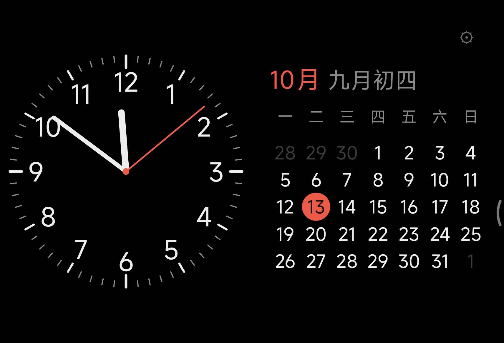
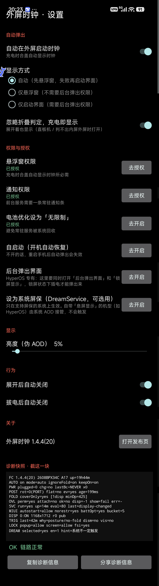

## 本仓库说明（Fork）

Fork 自 [roamroid/foldclock](https://github.com/roamroid/foldclock)（MIT License）。
原项目面向小米 18 Fold 的**外屏**，本 fork 的改动：

- **支持内屏**：选屏逻辑从「固定优先外屏」改为「优先当前亮着的屏」，折叠/展开均可用
- **内外屏统一触发条件**：插着电 + 手机横放才显示，竖持/平放立即收起（沿用原项目基于加速度计的姿态判定）
- 版本号：`1.5.0-oc1`
- 使用独立签名密钥，**安装前请先卸载官方 v1.4.4**（签名不同）

原项目的技术文档完整保留在 `docs/`——其中关于充电广播、合盖判定、HyperOS 外屏白名单、悬浮窗挂载的实机结论，是本 fork 的基础，功劳归原作者。

---

# 外屏时钟 · FoldClock

给折叠屏**外屏**做的一个极简时钟：合盖、插电，外屏自动亮起；纯黑背景 + 防烧屏像素偏移，适合长时间挂着当桌面钟。

> 主要为 **小米 18 Fold**（中折叠 / 阔折叠）的外屏调教；Android 12L（API 32）及以上可装。
> 其他折叠屏/直板机也能装，但外屏行为以实机为准。





## 功能

- **充电合盖自动亮起** —— 合盖判定问系统（「内屏灭、外屏亮」即算合盖），插上电自动显示，不用每次手动点
- **外屏悬浮窗** —— 直接把时钟画成悬浮窗，切换应用也不会被顶掉
- **锁屏下也能弹**（HyperOS 需额外授权两个权限，见下）—— 锁屏时悬浮窗在锁屏之上画不出来（实测），
  所以改用「系统全屏通知 + `showWhenLocked` 界面」把时钟盖到锁屏之上；从后台拉起界面靠
  HyperOS 的「后台弹出界面」+「锁屏显示」。这两项没开也能用，只是锁屏时不弹、解锁后才弹
- **横屏一套排版** —— 左时钟、右日历；外屏竖着的时候不显示，横过来才亮
- **防烧屏像素偏移** —— 画面每 15 秒在 2×2 像素里平滑挪一格，分散像素老化
- **伪 AOD** —— 可调亮度，最低 1%
- **可设为系统屏保（部分机型）** —— 内置 `DreamService`，走的是 AOSP 的屏保接口；
  但系统「屏保」入口很多 ROM 不在设置里显示，且自带**息屏显示 / AOD** 的机型（如 HyperOS）
  由系统 doze 接管息屏，AOSP 的 Dream 不会被拉起（实测：选中后息屏 50 秒仍是 `mCurrentDream=null`）
- **诊断快照** —— 一屏给出权限 / 充电 / 姿态 / 显示器 / 悬浮窗 / 触发链路 / MIUI 开关等状态，
  外加一个**结论码**（如 `E-NO-RESTRICT`），底部可一键复制或分享，用户截图即可定位问题
- **常驻通知条** —— 前台服务保活，可在系统里关掉

## 体积

| | |
|---|---|
| APK | **约 73 KB** |
| 依赖 | **零**（不用 AndroidX，不用 Compose，纯平台 API + 自绘 View） |
| 代码 | 16 个类，约 4700 行 Java |

当前版本：**v1.4.4**（versionCode 20）

实测机型：**小米 18 Fold**（Model 2608BPX34C / HyperOS）。

## 安装

1. 下载 Release 里的 APK
2. 点安装；若提示「未知来源」，去 **设置 → 应用 → 特殊权限 → 安装未知应用** 里允许一次
3. 小米/HyperOS 可能提示「未经安全检测」，选**继续安装**
4. 打开 App，按设置页引导依次授予：**悬浮窗** → **通知** → （小米）**自启动** → **电池无限制**

> ### 想让锁屏状态下也自动弹？还要开两个 HyperOS 专有权限
> 锁屏时系统的锁屏窗口在悬浮窗之上，**悬浮窗画不出来**（实测：窗口明明挂上了，
> 屏幕上却只有锁屏壁纸）。能盖住锁屏的只有 Activity，而从后台拉起 Activity 需要：
> **设置 → 应用设置 → 应用管理 → 外屏时钟 → 权限管理 → 其他权限**
> 里把 **「后台弹出界面」** 和 **「锁屏显示」** 都打开。
>
> 不开也能正常用 —— 只是锁屏时不会自动弹，解锁之后才弹。
> 自检面板里的 `LOCK popup=… screen=…` 就是这两项的状态。

> ### 小米 / HyperOS 必读：省电策略一定要设「无限制」
> 系统里的 **Greezer** 会在 App 于后台待久之后把它冻结，**连插电广播都不投递**，
> 表现就是「刚装好能用，过十几分钟插电就没反应了」。日志里能看到：
> ```
> BroadcastQueue: Greezer Denial: sending Intent { act=ACTION_POWER_CONNECTED ... }
>    due to receiver ProcessRecord{...} need cached broadcast
> ```
> 光设 AOSP 的电池优化白名单 / 自启动是不够的，必须去
> **设置 → 应用设置 → 应用管理 → 外屏时钟 → 省电策略 → 无限制**
> （顺手把「自启动」「通知」也打开）。设完这个，"插电没反应"就不会再出现了。

> 换签名会导致无法覆盖安装。本项目使用固定 release 密钥，后续版本可直接覆盖升级。

## 使用

- **当桌面钟**：合盖（微开的 A 形 / L 形立在桌上）→ 插电 → 外屏亮起横屏时钟。
  **手机竖着拿或平放时不显示**；显示中转到竖屏 / 放平会立刻退出；拔电自动收起（可关）。
  插电后**延迟 1 秒**才亮（iPhone 息屏那种节奏，不是"啪"一下跳出来）。
- **锁屏也能弹**（需上面那两个 HyperOS 权限）：锁屏状态下插电，时钟会盖在锁屏之上；
  第一次解锁时它自己退场，不占着你要用的桌面。展开 / 拔电 / 折叠态变化都会解除"已关掉"的抑制。
- **手动开**：通知条上有「显示 / 隐藏」。
- **设置页**（右上角齿轮）：默认**模拟表盘**、显示秒、显示农历、隐藏状态栏、防烧屏、屏幕常亮；
  亮度可调；保留「展开后自动关闭」「拔电自动关闭」；页面底部是**诊断快照 + 结论码**，可一键复制/分享。
  时钟本身**点不出开关**，退出走系统返回手势 / 拔电 / 展开。
- **当屏保（可选用，视系统而定）**：App 设置页里有「设为系统屏保」，点它会直接打开系统的
  `android.settings.DREAM_SETTINGS` 页面（很多 ROM 不在设置菜单里暴露这个入口，
  所以从这里进最直接）。**只在系统真的支持 AOSP 屏保时才会生效**；
  自带「息屏显示 / AOD」的机型（实测 HyperOS / 小米 18 Fold）由系统接管息屏，不会触发，
  这类机型请用上面的悬浮窗自动弹出。

## 为什么 v1.3.7 的「充电自动开启」是坏的

这一版重写的主要动机。老版本不是差一点没做成，而是**四条腿断了三条**：

| # | 问题 | 后果 |
|---|---|---|
| 1 | 没有开机接收器（清单里没有 `RECEIVE_BOOT_COMPLETED`） | 重启一次就永久失效，必须手动开一次 App |
| 2 | 用「常驻监听等合盖事件」判断合盖 | `TYPE_HINGE_ANGLE` **不是 wake-up 传感器**，合盖后 CPU 已挂起，事件根本不来 |
| 3 | 只走 `startActivity()` 弹界面 | 同时撞上 AOSP 的后台启动限制和厂商的「后台弹出界面」开关 |
| 4 | 没告诉系统「本应用允许在外屏运行」 | HyperOS 对外屏应用有白名单，不声明就不让你上外屏 |

新版分别对应：

1. 加 `BootReceiver`（`BOOT_COMPLETED` / `MY_PACKAGE_REPLACED`）
2. 改成**主动取样**：被插电广播唤醒后，临时切高频采样要一次当前角度，超时用缓存兜底
3. 默认改走**悬浮窗** —— 加一个 `TYPE_APPLICATION_OVERLAY` 窗口不属于「后台启动 Activity」，
   完全绕开两道闸。（真要启动界面时，用 `PendingIntent` + `MODE_BACKGROUND_ACTIVITY_START_ALLOWED`
   把自己的特权显式委托出去，这是 AOSP 认可的写法。）
4. 在 `<application>` 里声明外屏兼容属性，写法参考系统 App：

```xml
<property  android:name="android.window.PROPERTY_COMPAT_ALLOW_SMALL_COVER_SCREEN" android:value="1" />
<property  android:name="miui.continuity.policy"                                   android:value="5" />
<meta-data android:name="miui.supportFlipFullScreen"                               android:value="0" />
```

另外还修了：悬浮窗没盖满屏（底部漏桌面）、误判充电状态、反复弹窗、
`StandbyDreamService` 声明两遍、`debuggable=true` 被当 release 发出去等。

## 权限说明

| 权限 | 用途 |
|---|---|
| `SYSTEM_ALERT_WINDOW` | 以外屏悬浮窗形式显示时钟 |
| `FOREGROUND_SERVICE` + `FOREGROUND_SERVICE_SPECIAL_USE` | 常驻监听充电/折叠状态 |
| `POST_NOTIFICATIONS` | 前台服务所需的常驻通知条（可关闭） |
| `USE_FULL_SCREEN_INTENT` | 锁屏时用系统「全屏通知」把时钟界面拉到锁屏之上（Android 14+ 需用户在系统里允许） |
| `RECEIVE_BOOT_COMPLETED` | 开机后自动恢复常驻服务 |
| `HIGH_SAMPLING_RATE_SENSORS` | 插电唤醒瞬间短时高频读取手机姿态 |
| `REQUEST_IGNORE_BATTERY_OPTIMIZATIONS` | 引导用户把本应用设为「无限制」 |
| `WAKE_LOCK` | 保持屏幕常亮 |
| 传感器 `TYPE_ACCELEROMETER` | 读重力方向，判断手机是横着放还是平躺/竖着拿 |
| `BIND_DREAM_SERVICE`（service 侧） | 作为系统屏保运行（可选用；仅支持 AOSP 屏保的系统会触发） |

无网络、无位置、无通讯录、无存储读取。

## 隐私

**不联网、不收集、不上传。**

- 不申请 `INTERNET` 权限 —— App 在系统层面就无法访问网络
- 无统计 SDK、广告 SDK、崩溃上报 SDK
- 所有设置只存在本机 App 私有目录，卸载即删除

详见 [隐私政策](docs/隐私政策.md)。

## 自己构建

不需要 Android Studio，也不需要 Gradle。工程就是 `AndroidManifest.xml + res/ + src/`，
用 `aapt2 / javac / d8 / apksigner` 直接编译：

```sh
# 依赖：JDK 17、Android SDK build-tools（aapt2、d8、apksigner）、android.jar
# Termux 上：pkg install aapt2 openjdk-17

AJAR=/path/to/android-35/android.jar \
KS=~/keystores/foldclock.jks \
KSPASS=你的口令 \
sh build.sh
```

产物在 `build/FoldClock-<版本>.apk`。

可用环境变量：`AJAR` `KS` `KSPASS` `ALIAS` `OUTDIR` `TOOLCHAIN_SH`
（`TOOLCHAIN_SH` 指向一个 `source` 一下就能提供上述命令的脚本，方便嵌入式/手机上构建）。

脚本里**不存任何口令**，没给 `KSPASS` 会交互式询问。

## 已知限制

- 主界面固定横屏（外屏面板本身横向），外屏立着（竖屏）时**不显示**时钟
- 自动弹出依赖「悬浮窗」权限；部分系统还需额外允许「自启动」「后台弹出界面」
- **锁屏状态下自动弹出需要 HyperOS 的「后台弹出界面」+「锁屏显示」两个权限**：
  悬浮窗在锁屏之上画不出来，只能靠 Activity（`showWhenLocked`），
  而"从后台拉起 Activity"由厂商开关控制。没开时锁屏下不弹、解锁后才弹
- **系统屏保（Dream）不是通用路径**：HyperOS 等自带「息屏显示 / AOD」的机型由系统 doze
  接管息屏，AOSP 的 Dream 不会被拉起（实测息屏 50 秒 `mCurrentDream` 始终为 null）；
  这类机型只能靠悬浮窗自动弹出，第三方也无法往系统 AOD 上画动态内容
- 主要在小米 18 Fold（中折叠 / 阔折叠，HyperOS）上调教，其他折叠屏/直板机的外屏行为以实机为准
- HyperOS 对外屏应用有白名单，第三方应用自声明是否被采纳以实机为准

## 更新记录

### v1.4.4（2026-10-16）

- **锁屏状态下也能自动弹**：锁屏时改用 `showWhenLocked` 的 Activity + 系统「全屏通知」
  （实测悬浮窗在锁屏之上画不出来）。需要 HyperOS 的「后台弹出界面」「锁屏显示」，
  自检面板新增 `LOCK popup=… screen=… fsi=…` 一行显示状态
- **诊断面板重做**：一屏密集快照（权限 / 充电 / 姿态 / 显示器 / 悬浮窗 / MIUI 开关 / 触发链路）
  + 一个结论码（`E-…`），底部可一键复制或分享；信息密度按"一张截图定位问题"设计
- **设置页精简**：默认模拟表盘、显示秒、显示农历、隐藏状态栏、防烧屏、屏幕常亮；
  去掉「点击关闭」和旧的自检按钮；亮度仍可调；「关于」里加版本 + 打开发布页（不申请 `INTERNET`）
- **修掉一批实机取证发现的 bug**：
  - 插电广播被 Greezer 拦（省电策略必须「无限制」）、appop `10008` 自启动被重置
  - 姿态缓存过期导致"插着电、横着放却判成不是横放" → 改成主动取样
  - 「只成功一次」：全屏通知同 id 重复 post 只算更新，不再触发界面
  - 设置页被时钟盖住 / 返回时闪系统页面 / 进设置页的转场动画露出系统页面
  - 防烧屏 1 像素硬跳 → 改成 400ms 平滑过渡；锁屏时不再同时挂悬浮窗和 Activity（消重影）
  - 代码审查发现的 12 处状态泄漏与生命周期问题（详见 git log）
- 系统屏保（Dream）说明改为"部分机型可用"：HyperOS 上实测不会触发

## 许可

MIT，见 [LICENSE](LICENSE)。
